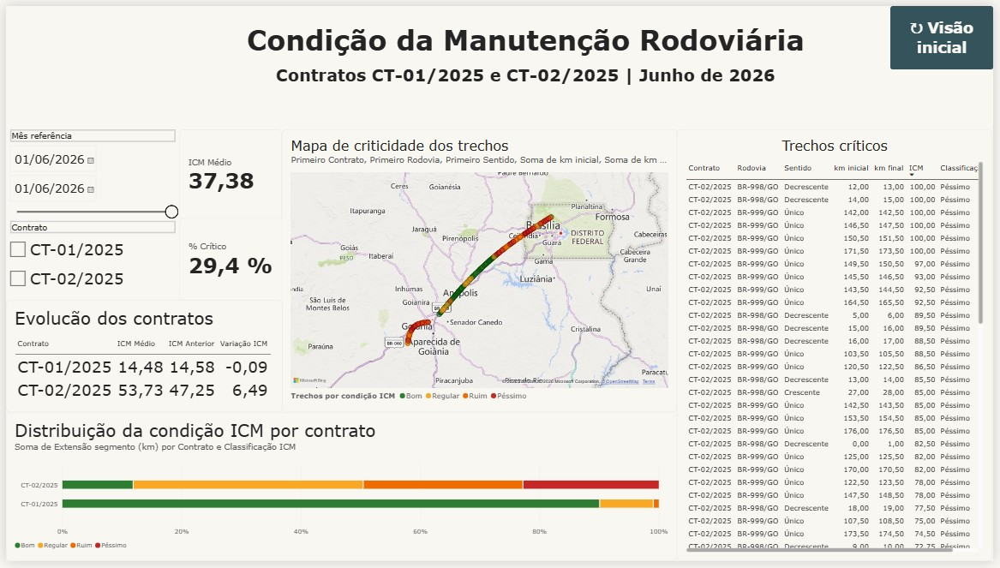

# Condição da Manutenção Rodoviária | Power BI

Projeto de análise de manutenção rodoviária com dados **inteiramente fictícios**, elaborado a partir de dois contratos de exemplo, CT-01/2025 e CT-02/2025. Inclui o painel original em Power BI, dados brutos e tratados, documentação, extração da definição do relatório e arquivos de apoio para análise com DeepSeek.

## Objetivo

Acompanhar a condição dos segmentos rodoviários, comparar contratos, identificar trechos críticos e visualizar a evolução mensal do Índice de Condição da Manutenção (ICM).

## Conteúdo do painel

- Filtros de mês de referência e contrato.
- Indicadores de ICM médio e percentual crítico.
- Evolução do ICM por contrato, com período anterior e variação.
- Mapa de criticidade dos trechos com classificação por cor.
- Distribuição percentual da extensão por classe de ICM.
- Tabela de segmentos críticos.

**Referência visual:** junho de 2026. O painel exibido mostra ICM médio de 37,38 e percentual crítico de 29,4%. São valores de referência da captura, sujeitos ao contexto dos filtros e à lógica das medidas no PBIX.

## Estrutura

| Pasta | Conteúdo |
|---|---|
| `powerbi/` | Relatório `.pbix` original e definições JSON extraídas para inspeção. |
| `dados/` | Planilhas original e tratada; CSVs de apoio. |
| `documentacao/` | PDF do painel, dicionário de dados, metodologia, guia DeepSeek e melhorias propostas. |
| `imagens/` | Captura de tela do dashboard. |
| `scripts/` | Script Python para auditoria reproduzível do CSV tratado. |

## Metodologia

A planilha tratada contém `LEVANTAMENTOS_TRATADOS`, `LOG_TRATAMENTO` e `PARAMETROS_ICM`, além das tabelas originais. O ICM na base tratada corresponde a `0,7 × IP + 0,3 × IC`. Quanto maior o ICM, pior a condição, de acordo com a classificação presente na base: Bom (<30), Regular (30 a <50), Ruim (50 a <70) e Péssimo (>=70). A classificação e os limites devem ser confirmados na planilha de parâmetros antes de qualquer mudança.

**Atenção:** médias simples e médias ponderadas pela extensão podem produzir resultados distintos. Não substitua medidas existentes sem verificar as expressões do relatório.

## Como abrir

1. Abra `powerbi/TesteBI.pbix` no Power BI Desktop.
2. Caso necessário, atualize a origem de dados para `dados/base-tratada.xlsx` e confira os tipos de coluna e relacionamentos.
3. Use o relatório e a documentação para validar indicadores e filtros.
4. Para trabalhar com DeepSeek, comece por `documentacao/PROMPT_DEEPSEEK.md` e anexe os arquivos relevantes. O DeepSeek não necessariamente abre `.pbix` diretamente: por isso estão disponíveis JSONs extraídos, CSVs e documentação.

## Qualidade e limites

- Dados simulados, sem correspondência com condições reais das rodovias.
- Coordenadas geográficas são usadas na visualização; não devem ser interpretadas como levantamento oficial.
- O PBIX é preservado, sem alegação de alterações no modelo ou nas medidas internas.
- O projeto contém artefatos de origem para auditoria e sugestões de melhoria, não um novo relatório validado.

## Tecnologias

Power BI, Power Query, DAX, Excel, CSV, JSON e Python.

## Licença e dados

Dados declarados fictícios na planilha fornecida. Consulte a origem dos arquivos antes de definir licença de redistribuição do projeto.
